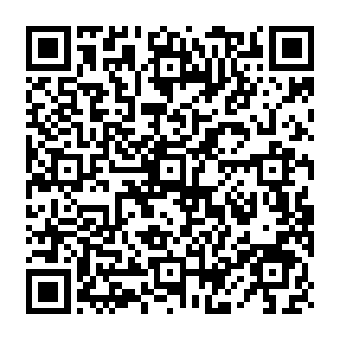

# Yu-Gi-Oh! Forbidden Memories — port nativo para PlayStation 2

Port **nativo** de *Yu-Gi-Oh! Forbidden Memories* (PS1, versão americana SLUS-01411) para o
PlayStation 2. Não é um emulador: o código do jogo (decompilado para C) é compilado para o
processador do PS2 (Emotion Engine, MIPS R5900) e a imagem é desenhada pelo chip gráfico do PS2
(o GS). Os dados do jogo (cartas, músicas, modelos 3D e vídeos) são lidos da sua própria imagem
`.bin` do disco, que **não** vem neste repositório.

- Como funciona por dentro, mapa das pastas e pontos de atenção para quem for analisar o código:
  **[ARQUITETURA.md](ARQUITETURA.md)**
- Projeto em que este port se baseia: a decompilação + port de PC
  [Unchiga/Yu-Gi-Oh-Forbidden-Memories-Recompiled](https://github.com/Unchiga/Yu-Gi-Oh-Forbidden-Memories-Recompiled)
  (commit `36d499c`). O README original está em
  [docs/projeto-base/README-original.md](docs/projeto-base/README-original.md).

## Como jogar

1. No pendrive (FAT32 ou exFAT), crie uma pasta (por exemplo `APPS/YFM`).
2. Copie para ela:
   - `release/YFM_PS2.ELF`
   - a imagem do seu disco renomeada para **`YFM.bin`** (o nome original
     `Yu-Gi-Oh! Forbidden Memories (USA).bin` também funciona).
3. No PS2 abra o ELF pelo OPL (como app) ou pelo wLaunchELF.
4. Os saves ficam em `YFM-SAVE/saves/` dentro da mesma pasta.

No PCSX2: *Sistema → Iniciar ELF*, com o `YFM.bin` na mesma pasta do ELF.

Controle: igual ao do PS1. Ao escolher o alvo de um ataque, **Quadrado** mostra a batalha 3D dos
monstros e **X** faz o ataque rápido.

## Situação

Testado no PCSX2 e num PS2 de verdade (USB exFAT, pelo OPL):

| Parte | Situação |
|---|---|
| Abertura, título, menus, nome, prólogo, montar deck | funciona |
| Duelos (mão, campo 3D, estrelas, fusão, campos, CPU) | funciona, 60 fps |
| Batalha 3D dos monstros (Quadrado) | funciona, 60 fps |
| Vídeos (STR) | 15 fps no PCSX2; no console ainda em ajuste |
| Som | funciona (mixado a 22 kHz) |
| Save / load | funciona: 5 slots em `YFM-SAVE/saves/` |

Ao ligar, o port mostra uma abertura da Retrogames e a tela "Apoie o projeto" (START pula a
abertura; X ou START na tela de apoio começa o jogo). As etapas da inicialização vão para o
`YFM-LOG.txt`, gravado ao lado do ELF. Se algo der errado, mande o `YFM-LOG.txt` e uma foto da tela.

## Como compilar

Precisa de Linux (ou WSL), `python3` e o toolchain do PS2 (`ps2dev`: ee-gcc, PS2SDK, gsKit e os
ports libpng, zlib e freetype).

```sh
export PS2DEV=/usr/local/ps2dev     # onde o ps2dev está instalado
./build.sh                          # compila e copia para release/YFM_PS2.ELF
```

O build não precisa da imagem do jogo.

## Créditos

Projeto **gratuito**, feito por fãs. Ele existe graças a:

- **[Yu-Gi-Oh! Forbidden Memories Recompiled](https://github.com/Unchiga/Yu-Gi-Oh-Forbidden-Memories-Recompiled)**
  (Unchiga e contribuidores) e **[memories-decomp](https://github.com/krystalgamer/memories-decomp)**
  (krystalgamer e colaboradores): o jogo decompilado em C, a base de todo o port.
- **[ps2dev](https://github.com/ps2dev/ps2dev)**, **[PS2SDK](https://github.com/ps2dev/ps2sdk)**,
  **[gsKit](https://github.com/ps2dev/gsKit)** e **[ps2sdk-ports](https://github.com/ps2dev/ps2sdk-ports)**:
  as ferramentas e bibliotecas do PS2.
- **[PCSX2](https://github.com/PCSX2/pcsx2)**, **[OPL](https://github.com/ps2homebrew/Open-PS2-Loader)** e
  **[wLaunchELF](https://github.com/ps2homebrew/wLaunchELF)**: para testar e rodar.

Feito por **Guilherme Soti** ([Retrogames Patos de Minas](https://github.com/guilhermesoti)), que
dirigiu o projeto e testou tudo num PS2 de verdade, com a ajuda de inteligências artificiais:
**Claude** (Anthropic) no desenvolvimento, **Gemini** (Google) e **ChatGPT** (OpenAI) nas revisões
técnicas e no conceito do menu de save. O que cada um fez está em **[CREDITOS.md](CREDITOS.md)**.

## Apoie o projeto

O port é e vai continuar gratuito. Se ele te ajudou e você quiser apoiar os próximos (como um port do
Tekken 3), pode doar qualquer valor:

<p align="center">
  <br>
  <b>Pix (chave aleatória):</b> <code>f19e4d1b-f35c-4541-919b-87a2cb540b9c</code>
</p>

<details>
<summary>Pix copia e cola</summary>

```
00020126580014br.gov.bcb.pix0136f19e4d1b-f35c-4541-919b-87a2cb540b9c5204000053039865802BR5914GUILHERME SOTI6014PATOS DE MINAS62070503***63048E1F
```
</details>

De fora do Brasil? / Outside Brazil? **[ko-fi.com/guilhermesoti](https://ko-fi.com/guilhermesoti)**

<a href="https://ko-fi.com/guilhermesoti"></a>

Toda doação é voluntária e não dá acesso a nada extra: o código e as builds continuam livres para
todo mundo. Obrigado por apoiar a cena retro!

## Licença

O código do port de PC e a camada PS2 (`src/ps2/`, `ps2/`, `build.sh`) estão sob a licença MIT (veja
[LICENSE](LICENSE)): mantenha o aviso de copyright e o link para os projetos de origem. O código
decompilado do jogo pertence aos autores do [memories-decomp](https://github.com/krystalgamer/memories-decomp).
*Yu-Gi-Oh!* e *Forbidden Memories* são da Konami; este repositório não tem o jogo nem seus dados, e
você precisa da sua própria cópia. Projeto sem ligação com a Konami.
