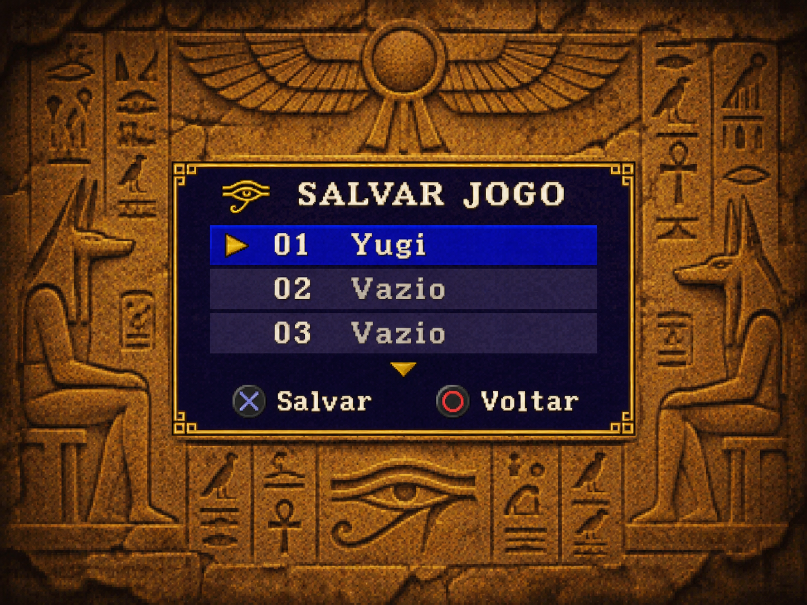

# Menu de salvar e carregar — especificação para implementação no PS2

Implemente no port nativo o menu aprovado por Guilherme na imagem abaixo. Use a mesma composição para **Salvar jogo** e **Carregar jogo**. A prioridade é reconhecer a seleção à distância e deixar a maior parte da cena visível na TV.

## Composição aprovada

A referência é uma tela 4:3. Trabalhe na grade lógica de **320 × 240**. A janela proposta mede **184 × 110 px**, aproximadamente um quarto da área da tela. Centralize em **x = 68, y = 65**. A largura arredonda os 185 px estimados no conceito. Essas medidas descrevem o painel visível. O retângulo de transferência para o GS pode ter o alinhamento exigido pelo backend.

| Elemento | Como reproduzir |
| --- | --- |
| Fundo | Deixe a cena do jogo visível ao redor da janela. Os relevos egípcios da referência mostram a composição desejada. Use o cenário da cena em que o menu foi aberto. |
| Moldura | Contorno fino em ouro antigo, sombra escura interna e pequenos cantos em degraus. O painel central é índigo opaco. |
| Cabeçalho | Pequeno Olho de Hórus dourado à esquerda do título. Use fonte bitmap clara, com traços legíveis na resolução nativa. Confira a largura do título mais longo, **CARREGAR JOGO**. |
| Lista | Três linhas visíveis. Número com dois dígitos à esquerda e nome do duelista ou estado do slot na mesma linha. Alinhe as duas colunas. “01 Yugi” é um exemplo da imagem. Leia os dados reais durante o jogo. |
| Seleção | Faixa azul-lápis, texto marfim e triângulo dourado apontando para a linha. O triângulo também identifica a seleção em uma TV com baixo contraste. |
| Rolagem | Reserve uma pequena área para o indicador acima ou abaixo da lista quando houver mais slots naquela direção. Mantenha o cursor visível ao cruzar o terceiro item e ao voltar ao primeiro. |
| Rodapé | Mostre o símbolo do botão seguido da ação curta. Use “Salvar” ou “Carregar” e “Voltar”. Derive os símbolos do mapeamento ativo do controle, inclusive quando círculo e cruz estiverem invertidos. |

**Guia de espaço.** Dentro dos 110 px de altura, reserve cerca de 22 px para o título, 3 linhas de 16 px para os slots, 10 px para o indicador de rolagem e 22 px para os comandos. Os 8 px restantes acomodam bordas e respiros. Use a imagem para ajustar as proporções antes de diminuir a fonte.

## Encaixe no código existente

- Em `src/pc/saves/save_menu.c`, adapte a apresentação de `SaveMenu_Draw()` para PS2. A lista já usa `menu.cursor`, `menu.top` e `shown_rows`. Informe as três linhas ao mecanismo existente e preserve o total de slots. Use `selectable()` e o estado real de cada entrada para distinguir ocupado, vazio, ilegível e danificado.
- Preserve a identificação do slot atual e os modos de escolha para jogador 1 e jogador 2. Abrevie nomes longos na lista de acordo com a largura medida da fonte. Mostre nome e detalhes disponíveis na confirmação de sobrescrita. Confirmações e erros podem usar o espaço da lista para acomodar a mensagem completa e os comandos.
- Em `src/ps2/platform_ps2.c`, confira `Ps2_OverlayBox()`. Hoje ela usa um canvas com deslocamento vertical de 24 px, compartilhado com o menu de baralho e os avisos. A posição proposta está em coordenadas da **tela inteira**. Aplique o deslocamento uma única vez e restrinja o novo tamanho às telas de save/load.
- Em `src/ps2/gs_gpu.c`, confira a transferência do painel. O backend alinha o retângulo horizontal a múltiplos de oito pixels. Verifique as duas margens depois do arredondamento para evitar uma faixa azul fora da moldura. Continue usando o painel opaco e a atualização por mudança de estado já presentes no port.

## Entrega e critérios de aceite

1. Gere o ELF de teste e capture **Salvar jogo** e **Carregar jogo** em 4:3. Compare a ocupação da tela, a posição da moldura e a legibilidade com a imagem aprovada.
2. Com um slot de teste, percorra do primeiro ao último e volte. Confira três linhas visíveis, seleção, indicadores, nomes longos e estados vazios. Valide a legenda de botões nos dois mapeamentos.
3. Salve em um slot vazio, cancele uma sobrescrita, confirme uma sobrescrita no slot de teste e carregue o resultado. Confira mensagens, identificação do arquivo e retorno à cena de jogo.
4. Ao abrir, rolar e fechar, verifique se ficam pixels da caixa na cena, se aparece texto do jogo por dentro do painel ou se há rasgos na imagem. Registre o que foi verificado em emulador e o que foi confirmado no PS2 físico.
